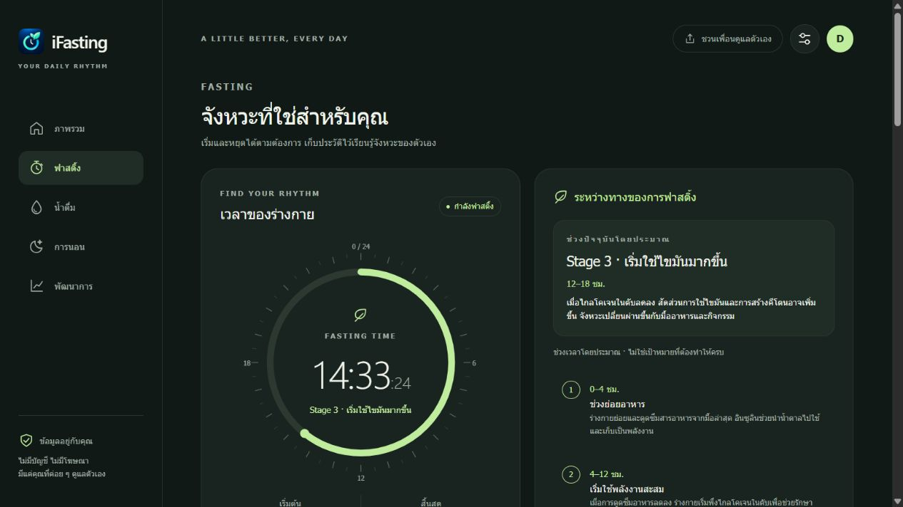
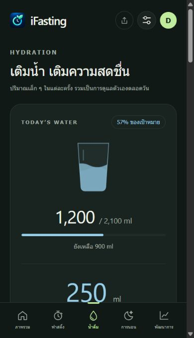
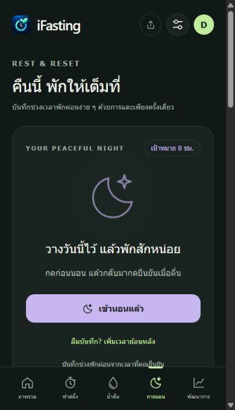
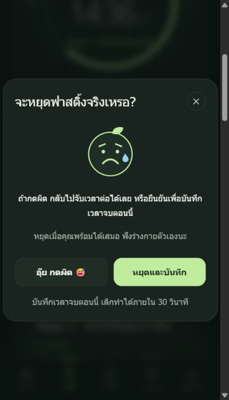
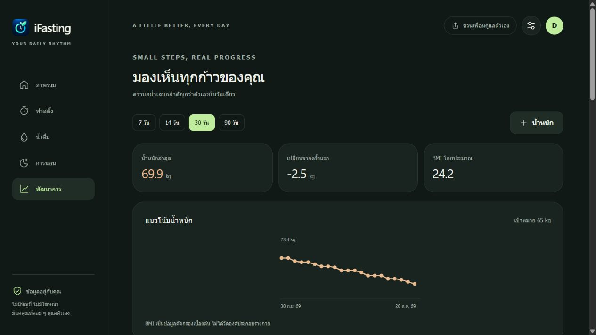

<p align="center">
  
</p>

<h1 align="center">iFasting</h1>

<p align="center"><strong>ฟาสติ้งในจังหวะของคุณ ดูแลตัวเองทีละนิดทุกวัน</strong></p>
<p align="center">ติดตามฟาสติ้ง น้ำดื่ม น้ำหนัก และการพักผ่อนในที่เดียว<br>ไม่ต้องสมัครสมาชิก · ไม่มีโฆษณา · ข้อมูลสุขภาพอยู่ในเครื่องคุณ</p>

<p align="center">
  <a href="https://bunnamchaib.github.io/IFasting/"><strong>เปิดใช้ iFasting →</strong></a>
  · <a href="./docs/INSTALLATION.md">ติดตั้งบนมือถือ</a>
  · <a href="#features">ฟีเจอร์</a>
  · <a href="#technology">เทคโนโลยี</a>
  · <a href="#development">พัฒนาต่อ</a>
</p>



<p align="center"><em>Your health. Your pace. Your journey.</em></p>

## Features

| ฟีเจอร์ | สิ่งที่ทำได้ |
| --- | --- |
| **Fasting ที่ยืดหยุ่น** | เริ่ม/หยุดเอง ไม่บังคับโปรแกรม จับเวลาต่อเมื่อกลับมาเปิดแอป พร้อม 5 Stage โดยประมาณตามเวลาที่บันทึก |
| **กันเผลอหยุด** | ทั้งการเลื่อนและกดปุ่มต้องยืนยันก่อน มีหน้าเศร้านิด ๆ ให้เปลี่ยนใจ และเลิกทำได้ภายใน 30 วินาที |
| **น้ำดื่มแต่ละวัน** | เลือกปริมาณด้วยสไลเดอร์หรือปุ่มลัด ตั้งเป้าหมาย ดูประวัติและกราฟย้อนหลัง |
| **เห็นพัฒนาการ** | บันทึกน้ำหนักพร้อมวันเวลา ดูกราฟ 7 / 14 / 30 / 90 วัน เป้าหมาย และ BMI โดยประมาณ |
| **พักผ่อนให้เป็นจังหวะ** | บันทึกเข้านอน/ตื่น เพิ่มย้อนหลังข้ามคืน และตั้งช่วงเวลาถาม Smart Sleep Check-in |
| **ปรับให้เป็นคุณ** | ภาษาไทย/อังกฤษ ธีมมืด/สว่าง/ตามเครื่อง และรูปโปรไฟล์ที่ย่อเป็นภาพเล็กก่อนเก็บ |
| **ข้อมูลพกไปได้** | ส่งออก JSON พร้อมชื่อไฟล์อ่านง่าย นำเข้าตรวจสอบก่อนเลือกรวมหรือแทนที่ข้อมูล |
| **เปิดเหมือนแอป** | เพิ่มไอคอนบนหน้าจอโฮม รองรับ PWA และเปิดออฟไลน์หลังโหลดออนไลน์สำเร็จครั้งแรก |

### เล็ก ๆ น้อย ๆ ที่ใส่ใจ

รูปโปรไฟล์ย่อเหลือ **128 × 128 px** และเก็บ Base64 ไปกับไฟล์สำรอง ไม่ต้องมีเซิร์ฟเวอร์เก็บรูป ส่วนไฟล์ JSON ตั้งชื่อแบบ `iFasting-Backup-ชื่อเล่น-วันที่_เวลา.json` เพื่อให้หาไฟล์ของตัวเองเจอง่าย

## Screenshots

<table>
  <tr>
    <th align="center">เติมน้ำ</th>
    <th align="center">พักผ่อน</th>
    <th align="center">กันกดผิด</th>
  </tr>
  <tr>
    <td></td>
    <td></td>
    <td></td>
  </tr>
</table>



ภาพทั้งหมดจับจากแอปจริงโดยใช้ **ข้อมูลจำลองสำหรับสาธิต** ตัวเลขในภาพไม่ใช่ข้อมูลสุขภาพของผู้ใช้หรือผลลัพธ์ที่แอปรับรอง

## Technology

| ส่วนของระบบ | เทคโนโลยีที่ใช้ |
| --- | --- |
| หน้าจอและการจัดวาง | **HTML5 + CSS3** แบบ responsive, CSS variables และธีมตามระบบ |
| การทำงานของแอป | **Vanilla JavaScript** — HTML, CSS และ JavaScript หลักอยู่ใน `index.html` ไม่มี runtime framework หรือขั้นตอน build |
| ตัวจับเวลาและกราฟ | **SVG** สำหรับวงแหวน ไอคอน และกราฟ; timestamp สำหรับคำนวณเวลาที่ผ่านไป |
| ฐานข้อมูลในเครื่อง | **IndexedDB** พร้อม transaction แบบ atomic และตรวจการแก้ไขจากฟอร์มเก่าเมื่อเปิดหลายแท็บ |
| รูปโปรไฟล์และไฟล์สำรอง | **Canvas + JPEG/Base64 + JSON** ประมวลผลรูปและข้อมูลในเบราว์เซอร์ |
| ติดตั้งและออฟไลน์ | **Web App Manifest + Service Worker** พร้อมไอคอน iPhone / PWA |
| เผยแพร่ | **GitHub Pages** เสิร์ฟไฟล์ static ผ่าน HTTPS |
| ทดสอบสำหรับผู้พัฒนา | **Node.js built-in test runner** และ syntax checks; ตัวแอปไม่ต้องใช้ Node.js เพื่อทำงาน |

### เริ่มใช้บน iPhone

เปิด [iFasting](https://bunnamchaib.github.io/IFasting/) ใน **Safari → แชร์ → เพิ่มไปยังหน้าจอโฮม → เพิ่ม** หากมีตัวเลือก **เปิดเป็นเว็บแอป** ให้เปิดไว้ แล้วแตะไอคอนบนหน้าจอโฮมเพื่อใช้งานครั้งต่อไป

ปุ่ม **ติดตั้งแอป** ในหน้าต้อนรับและหน้าภาพรวมช่วยเปิดคำแนะนำ ส่วนเบราว์เซอร์ที่รองรับหน้าติดตั้งโดยตรงจะแสดงหน้าติดตั้งให้ ดูรายละเอียดใน [คู่มือติดตั้ง](./docs/INSTALLATION.md)

### ข้อมูลของคุณอยู่กับคุณ

ไม่มีบัญชีหรือระบบซิงก์ข้อมูลสุขภาพขึ้นเซิร์ฟเวอร์ ปุ่มแชร์ส่งเฉพาะลิงก์แอป ข้อมูลแต่ละเบราว์เซอร์/อุปกรณ์อาจแยกกัน ควรส่งออกไฟล์สำรองก่อนย้ายเครื่องหรือล้างข้อมูลเว็บไซต์

Stage ของฟาสติ้งเป็นความรู้ทั่วไปตามเวลา ไม่ได้ตรวจวัดภาวะร่างกายจริง แอปใช้ติดตามพฤติกรรมและไม่ใช่เครื่องมือวินิจฉัย

---

<a id="development"></a>

## สำหรับคนที่จะพัฒนาต่อ

คู่มือทางเทคนิคจาก README เดิมอยู่ด้านล่าง ครอบคลุมไฟล์ที่ใช้ รันในเครื่อง เผยแพร่ โครงสร้างข้อมูล และข้อจำกัด พร้อมอัปเดตคำสั่งทดสอบให้ใช้ชุดทดสอบทั้งหมด

เอกสารเพิ่มเติม: [การติดตั้ง](./docs/INSTALLATION.md) · [Fasting Stage](./docs/FASTING-STAGES.md) · [รูปโปรไฟล์และภาษา](./docs/PROFILE-LANGUAGE.md) · [ไอคอน](./docs/ICON-ASSETS.md)

<details>
<summary><strong>เปิดอ่านคู่มือเดิมสำหรับผู้พัฒนา</strong></summary>

แอปติดตาม Fasting, น้ำดื่ม, น้ำหนัก และการพักผ่อน แบบ Local-first PWA ไม่ต้องสมัครสมาชิก ไม่มีไลบรารีภายนอกหรือขั้นตอน build

### ไฟล์ที่ใช้ขึ้นเว็บ

- `index.html` — ตัวแอปทั้งหมด รวมหน้าจอ CSS และ JavaScript ในไฟล์เดียว
- `sw.js` — เก็บตัวแอปไว้เปิดออฟไลน์หลังเปิดออนไลน์สำเร็จครั้งแรก
- `manifest.webmanifest` — ชื่อแอป ไอคอน และข้อมูลสำหรับติดตั้ง
- `icon-192.png`, `icon-512.png` — ไอคอน PWA จากภาพนาฬิกาและใบไม้ที่ผู้ใช้เลือก
- `apple-touch-icon.png` — ไอคอน iPhone 180 × 180 px แบบพื้นหลังเต็มสี่เหลี่ยม ให้ระบบตัดมุม
- `favicon.png` — ไอคอนแท็บเบราว์เซอร์ 32 × 32 px
- `.nojekyll` — ให้ GitHub Pages เสิร์ฟไฟล์แบบ static

ต้นฉบับความละเอียดสูงอยู่ใน `icon-master.png` ดูแนวทางทำไอคอนใน `docs/ICON-ASSETS.md`

ใช้ `index.html` เพียงไฟล์เดียวผ่านเว็บได้ แต่การติดตั้งและออฟไลน์เต็มรูปแบบต้องมีไฟล์เสริมข้างต้น ห้ามเปลี่ยน `sw.js` เป็น blob/data URL เพราะเบราว์เซอร์ต้องใช้ HTTP(S) URL ของสคริปต์จริง

### ทดลองในเครื่อง

เปิด CMD ที่โฟลเดอร์หลัก แล้วรัน:

```text
python -m http.server 4173 --bind 127.0.0.1
```

เปิด http://127.0.0.1:4173/ ข้อมูลทดลองจะอยู่ในเบราว์เซอร์ของที่อยู่นี้เท่านั้น ผู้ใช้ที่เปิด GitHub Pages จะเริ่มด้วยฐานข้อมูลว่างของตัวเอง ไม่มีข้อมูล Demo ฝังในแอป

### อัปโหลด GitHub Pages

1. Clone repository นี้ หรือคัดลอกไฟล์สำหรับขึ้นเว็บที่ระบุด้านบนไปไว้ที่ root ของ repository ที่ต้องการ
2. ใน GitHub เปิด Settings → Pages → Source: Deploy from a branch
3. เลือก branch ที่มีไฟล์ เช่น `main` และโฟลเดอร์ `/(root)` แล้ว Save
4. เมื่อเผยแพร่สำเร็จ เปิดลิงก์ HTTPS ที่ GitHub แสดง ทดลองตั้งค่าและบันทึกก่อนแชร์ให้เพื่อน
5. ปุ่มแชร์ส่งเฉพาะลิงก์แอป เปิด share sheet เมื่อรองรับ หรือคัดลอกลิงก์ให้ ถ้าเปิดผ่าน localhost จะอธิบายว่าต้องเผยแพร่ก่อน

ไฟล์ทั้งหมดใช้ relative paths จึงรองรับ URL แบบ `https://ชื่อผู้ใช้.github.io/ชื่อโปรเจกต์/` ไม่ต้องแก้ base path

อ้างอิง: [GitHub Pages publishing source](https://docs.github.com/en/pages/getting-started-with-github-pages/configuring-a-publishing-source-for-your-github-pages-site), [Service worker registration](https://developer.mozilla.org/en-US/docs/Web/API/ServiceWorkerContainer/register), [Web Share API](https://developer.mozilla.org/en-US/docs/Web/API/Navigator/share)

### ระบบที่ทำงานแล้ว

- Onboarding พร้อมรายละเอียดการใช้และโปรไฟล์ หรือเริ่มจากนำเข้าไฟล์สำรอง
- Dashboard และหน้าฟาสติ้ง / น้ำดื่ม / การนอน / พัฒนาการ เมนูล่างบนมือถือและ sidebar บนจอใหญ่
- Fasting แบบไม่บังคับโปรแกรม ใช้ timestamp จับเวลาต่อเมื่อปิดแอป วงแหวน 24 ชั่วโมงนับเวลารวมต่อได้ เลื่อนหรือกดแล้วต้องยืนยันก่อนหยุด และ Undo 30 วินาที
- น้ำดื่มเลือกด้วย slider/ปุ่มลัด บันทึกปริมาณกับเวลา แก้ไข ลบ Undo กราฟยอดรายวัน
- น้ำหนักพร้อมวันเวลา ประวัติ กราฟ 7/14/30/90 วัน BMI และเป้าหมาย
- นอน: เข้านอน/ตื่น หรือบันทึกย้อนหลังข้ามคืน กราฟชั่วโมงพักผ่อน ถาม check-in เมื่อเปิดแอปในช่วงที่ตั้งไว้ ไม่ถามซ้ำในวันนั้นเมื่อไว้ทีหลัง
- ตั้งค่าโปรไฟล์ เป้าหมาย ช่วงถามเรื่องนอน และธีม dark/light/system
- อัปโหลดรูปโปรไฟล์: ตัดกึ่งกลางและย่อเป็น JPEG 128 × 128 px เก็บ Base64 ในเครื่องและ JSON สูงสุด 20,000 ตัวอักษร (ข้อมูลภาพประมาณ 15 KB) มีปุ่มเปลี่ยน/ลบรูป ไม่มีการอัปโหลดไปเซิร์ฟเวอร์
- เลือก TH / EN ก่อนเริ่มใช้ครั้งแรก และเปลี่ยนได้ใน Settings ภาษาและรูปติดไปกับไฟล์สำรอง ไฟล์ v1 เดิมที่ไม่มีข้อมูลสองส่วนนี้ยังนำเข้าได้
- Export JSON; Import ตรวจรูปแบบก่อน แสดงจำนวนรายการ แล้วเลือก merge/replace โดยต้องยืนยัน; Reset ต้องพิมพ์ RESET
- ไฟล์สำรองตั้งชื่อ `iFasting-Backup-ชื่อเล่น-YYYY-MM-DD_HH-mm-ss.json` ตามเวลาท้องถิ่น หากไม่มีชื่อเล่นใช้ `MyJourney` แทน รองรับชื่อภาษาไทยและตัดอักขระที่ใช้ในชื่อไฟล์ไม่ได้
- IndexedDB บันทึกแบบ atomic และป้องกันการแก้/ลบรายการจากฟอร์มที่ล้าสมัยเมื่อเปิดหลายแท็บ

### ข้อมูลและข้อจำกัดรุ่นแรก

- ข้อมูลผูกกับ origin/เบราว์เซอร์/อุปกรณ์ ไม่มีบัญชี ไม่มีซิงก์ข้ามเครื่องหรือการแชร์ข้อมูลสุขภาพ ล้าง site data แล้วข้อมูลอาจหาย ควรส่งออกสำรองเป็นระยะ
- ถ้าอ่านฐานข้อมูลผิดพลาด แอปจะหยุดและแสดงข้อผิดพลาด ไม่สร้างข้อมูลว่างทับของเดิม
- ประวัติในหน้าจอแสดง 30 รายการล่าสุดต่อหมวด; กราฟและ Export ใช้ข้อมูลทั้งหมด
- Merge เทียบ ID และ updatedAt ใช้รายการที่แก้ล่าสุด เก็บโปรไฟล์/รอบปัจจุบันของเครื่องนี้ก่อน รายการที่ลบไปแล้วอาจกลับมาได้ถ้านำเข้าไฟล์เก่าที่มีรายการนั้น (ยังไม่มีระบบ sync/tombstone)
- เปลี่ยนเวลาเครื่องมีผลต่อตัวจับเวลา เฟสร่างกายเป็นข้อมูลทั่วไป ไม่ได้ตรวจน้ำตาล/การเผาผลาญ/autophagy และ Sleep บันทึกช่วงพักผ่อน ไม่ใช่เวลาหลับที่ตรวจวัดจริง
- Offline ต้องเปิดออนไลน์ครั้งแรกให้ Service Worker ติดตั้งเสร็จ ไม่มีการแจ้งเตือนขณะปิดแอป
- ทดสอบด้วยเบราว์เซอร์ในเครื่องแล้ว แต่การติดตั้ง PWA, Files และ share sheet บน Safari/iPhone จริงยังต้องตรวจบนอุปกรณ์
- เมื่อออกเวอร์ชันใหม่ให้เพิ่มชื่อ CACHE ใน `sw.js` หากเปลี่ยน shell/assets; ตัวแอปใช้ network-first และอาจต้องปิดแท็บเดิมแล้วเปิดใหม่เพื่อ activate worker รุ่นใหม่

### สำหรับพัฒนาต่อ

โครงสร้างใน HTML แยก `domain` (คำนวณ/ตรวจข้อมูล), Storage adapter (IndexedDB), views และ controllers ไม่ควรเขียนฐานข้อมูลตรงจากหน้าจอใหม่ ให้ผ่าน commit/transaction เสมอ

รันทดสอบ:

```text
node --test tests/*.test.cjs
node --check sw.js
```

</details>
